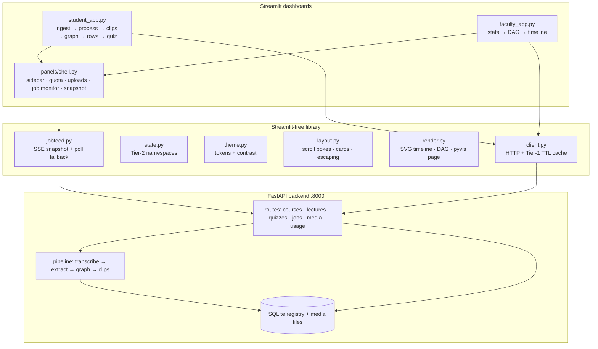
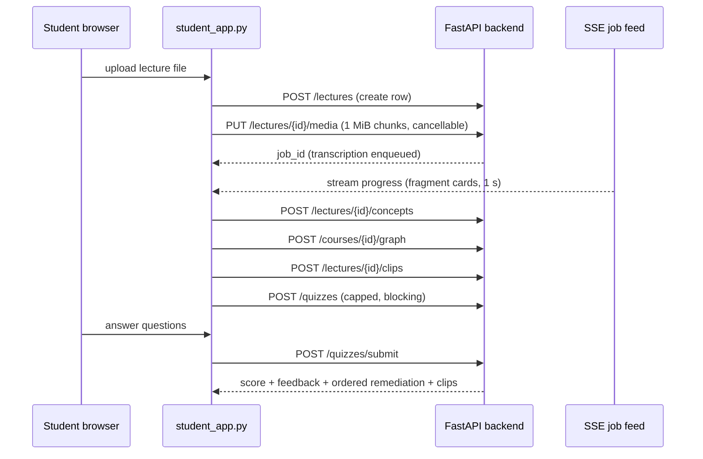
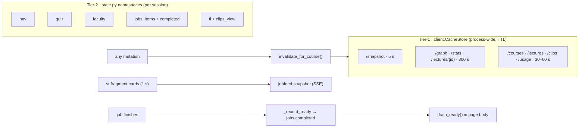

# 18 · Diagrams and presentation material

Copy-paste sources for architecture diagrams (Mermaid) and a slide outline.
All node names and flows are taken from files 01–15; nothing here invents a
component.

## Component diagram (Mermaid)

## Upload-to-remediation sequence (Mermaid)

## State-tier diagram (Mermaid)

## Slide outline (12 slides)

1. **Title** — LecGap: Lecture Comprehension Gap Detector; one-line promise
   (upload a lecture, get a personalised study plan).
2. **Problem** — lecture content is linear; student confusion is invisible
   until the exam. Faculty can't see taught-vs-learned divergence.
3. **Pipeline** — transcribe (Whisper) → extract concepts + spoken links →
   build DAG → cut clips → quiz → remediate. Use the sequence diagram.
4. **Two dashboards** — student (do the work) vs faculty (see the learning);
   same sidebar, banner, quota row, snapshot; shared backend and database.
5. **Live without reloads** — SSE feed + 1 s fragment cards; the
   restart-every-video defect this replaced; completion announcements in the
   page body, never the fragment.
6. **Two-tier state** — Tier-1 TTL cache with one invalidation rule; Tier-2
   namespaces; 5 s snapshot as the cross-session consistency layer.
7. **Quiz → remediation** — 15-question cap (why: 74 radios, minutes frozen);
   one-shot submit; wrong answers trace prerequisites backwards into an
   ordered clip-backed study list.
8. **Faculty analytics** — confusion heatmap (block bars), taught-vs-learned
   arrows, lecture coverage timeline (green = pinned-down speech).
9. **One colour system** — semantic tokens, measured (never eyeballed) ink,
   WCAG AA pinned per token per surface; light values on a dark page as the
   motivating bug.
10. **Contracts and guards** — `{detail}` errors not tracebacks; no
    filesystem paths in players (media endpoint + range); duplicate-upload
    guard; one-pipeline-job-per-lecture rule; resumable-vs-abandoned triage.
11. **Known gaps (honest slide)** — auth banner condition never fires;
    snapshot/stats untyped; blocking quiz generation (queued job planned);
    `accent` == `info`. Each is one line with its file reference.
12. **What next** — queued quiz generation (C2), typed snapshot/stats
    schemas, auth-kind recording; the React engine now carries these forward.
